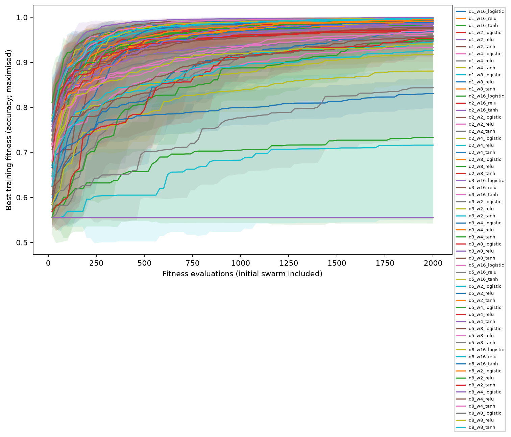
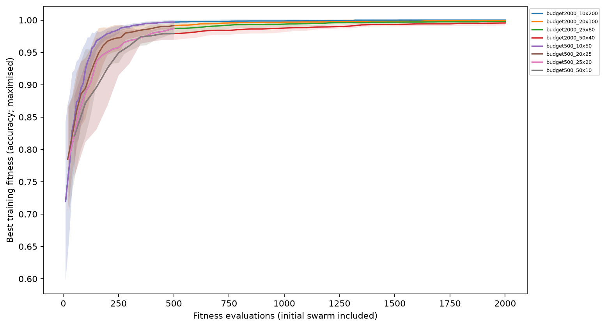
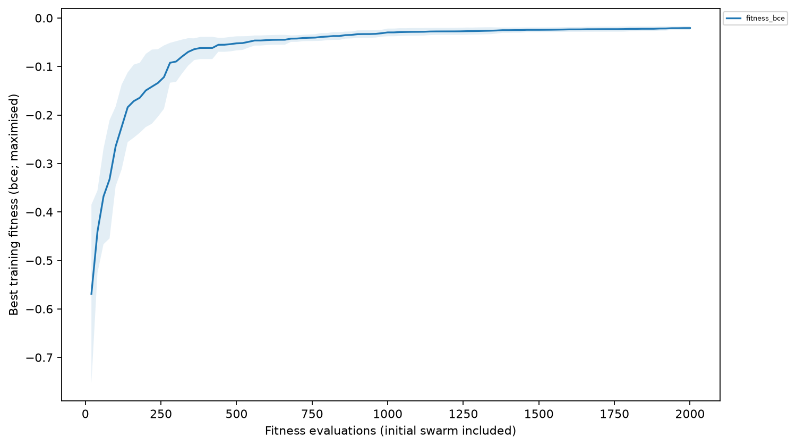

# Training a Neural Network with Particle Swarm Optimization

A feedforward ANN and the informant-based PSO of Luke (2013), Algorithm 39,
both implemented from scratch in Python/NumPy, coupled to classify the UCI
Banknote Authentication dataset. scikit-learn is used only for the stratified
70:30 split and `StandardScaler`.

The [Banknote Authentication dataset](https://doi.org/10.24432/C55P57) is by Volker Lohweg (2012), published by the UCI Machine Learning Repository under [CC BY 4.0](https://creativecommons.org/licenses/by/4.0/).

## Experiment visualizations

The plots show how the best training fitness changes as PSO evaluates more candidate networks.

**Network architecture**



<details>
<summary>Swarm size and generation budget</summary>



</details>

<details>
<summary>PSO coefficients</summary>


</details>

<details>
<summary>Boundary handling, activation encoding, and fitness functions</summary>





</details>

Python 3.10+. Run commands from the repository root.

## 1. Install

```bash
python -m venv .venv
source .venv/bin/activate          # Windows: .venv\Scripts\activate
python -m pip install -r requirements.txt
```

## 2. Project layout

| Path | Contents |
|------|----------|
| `src/activations.py` | logistic (numerically stable), ReLU, tanh and a name registry |
| `src/ann.py` | configurable feedforward `ANN`: `forward`, `predict`, `set_params`, `get_parameters_vector` |
| `src/pso.py` | `PSO` class following Algorithm 39 (comments give the line numbers), plus clip / reflect / reset boundary handling and an optional inertia schedule |
| `src/coupling.py` | maps a particle vector onto the ANN and builds the fitness function (accuracy, -MSE or -BCE); optional particle-encoded hidden activations |
| `src/data.py` | loads the dataset, stratified 70:30 split (seed 42), training-only scaling |
| `src/metrics.py` | confusion matrix, accuracy, precision, recall, F1 |
| `src/neural_network.py` | thin wrapper used by the root-level demo scripts |
| `experiments/` | configuration grids, seeded runner (seeds 0-9, resumable) and the four experiment scripts |
| `analysis/make_tables_plots.py` | mean ± SD tables, convergence plots, optional Welch test |
| `tests/` | 18 unit tests |
| `results/` | saved CSVs, metadata, best particles (`*_artifacts/*.npz`) and figures |
| `data/` | `data_banknote_authentication.txt` |

## 3. Check the implementation

```bash
python -m unittest discover -s tests -v   # 18 tests, expect OK
python -m src.pso                          # sphere benchmark, expect "Sphere benchmark passed"
python -m src.data                         # train (960, 4), test (412, 4)
python test_activations.py
python test_neural_network.py
python test_parameters.py
python -m experiments.smoke                # one short PSO run on the training data
```

## 4. Reproduce the experiments

Each configuration is run with seeds 0-9. Results are written to `results/csv/`.
Add `--list` to any experiment command to print its configurations without running.

```bash
# Experiment 1: architecture grid (depths 1,2,3,5,8 x widths 2,4,8,16 x tanh/logistic/ReLU)
python -m experiments.exp1_architecture
# Select the architecture with the highest mean TRAINING accuracy
python -m experiments.runner select --csv results/csv/exp1.csv --output results/architecture.json

# Experiments 2-4 use the selected architecture as their base configuration
python -m experiments.exp2_budget       --base results/architecture.json   # swarm size x generations
python -m experiments.exp3_coefficients --base results/architecture.json   # beta/gamma balance, alpha, delta
python -m experiments.exp4_extensions   --base results/architecture.json   # boundary, fitness, encoded activation
```

The result CSVs already in `results/csv/` are the ones used in the report. A
script refuses to overwrite an existing CSV; pass `--resume` to continue an
interrupted suite (configs, seeds and dataset must be unchanged), or use
`--output` to write elsewhere.

## 5. Tables and plots

```bash
python -m analysis.make_tables_plots --csv results/csv/exp1.csv --output results/figures/exp1
python -m analysis.make_tables_plots --csv results/csv/exp2.csv --output results/figures/exp2
python -m analysis.make_tables_plots --csv results/csv/exp3.csv --output results/figures/exp3
python -m analysis.make_tables_plots --csv results/csv/exp4.csv --output results/figures/exp4
```

Optional: `--compare SETTING_A SETTING_B [--metric train_accuracy]` adds a Welch t-test.

## 6. Implementation notes

- **Particle encoding.** For each layer, the row-major weight matrix followed by
  its bias vector; dimension `sum((n_in + 1) * n_out)` (13 for `[4, 2, 1]`).
  With encoded activations, one extra coordinate per hidden layer in `[0, 3)`
  selects tanh / logistic / ReLU by its integer part. The output layer is always
  logistic and class 1 is predicted when its output is at least 0.5.
- **PSO.** Every fitness is maximised. The informant group of each particle
  includes itself and is resampled every generation. All particles are assessed
  before any velocity update, and moves are synchronous. `iterations` counts
  assessed generations including the initial swarm, so a run makes exactly
  `swarm_size * iterations` evaluations. Initial velocities lie within ±10% of
  the bound width.
- **Boundary handling.** `clip` sets an escaping coordinate to the bound and zeroes
  its velocity; `reflect` mirrors it back and reverses its velocity; `reset`
  resamples it uniformly and zeroes its velocity.
- **Evaluation.** Fitness uses training data only. After a run the best particle
  is loaded once and the test predictions are reused for all test metrics.
- **Saved outputs.** One CSV row per run (config, metrics, convergence history,
  test confusion matrix, chosen activations), a `.metadata.json` per suite, and
  an `.npz` per run with the best particle and scaler statistics.

## Use of generative AI

See `AI_USAGE.md` and Appendix A of the report.
