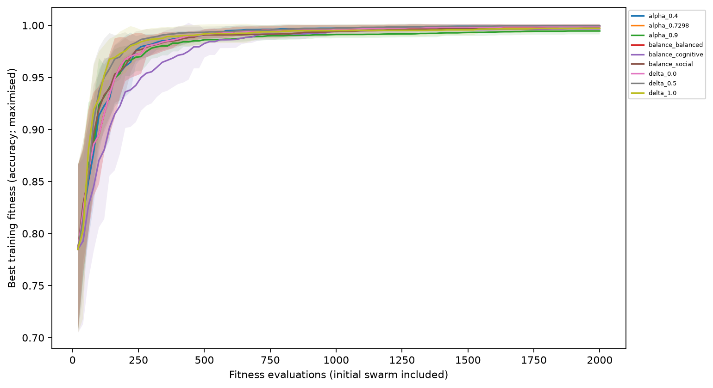
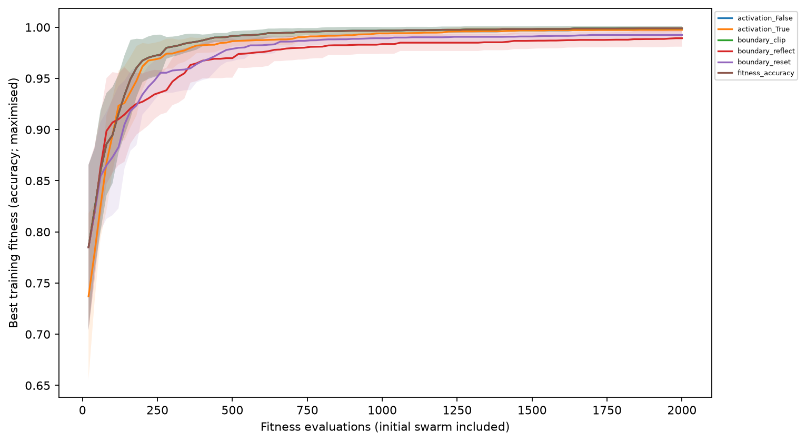
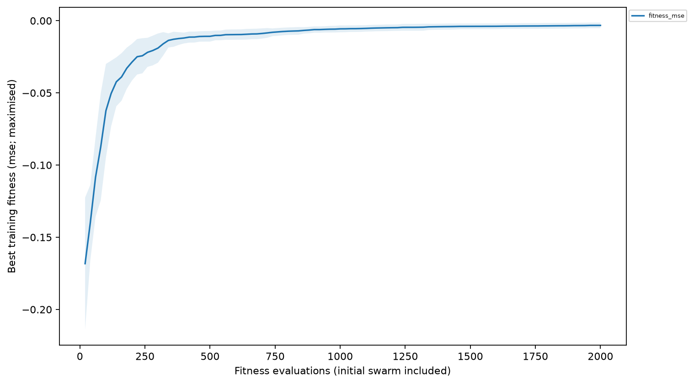

# Training a Neural Network with Particle Swarm Optimization

A feedforward ANN and the informant-based PSO of Luke (2013), Algorithm 39,
both implemented from scratch in Python/NumPy, coupled to classify the UCI
Banknote Authentication dataset. scikit-learn is used only for the stratified
70:30 split and `StandardScaler`.

The [Banknote Authentication dataset](https://doi.org/10.24432/C55P57) is by Volker Lohweg (2012), published by the UCI Machine Learning Repository under [CC BY 4.0](https://creativecommons.org/licenses/by/4.0/).

## Experiment visualizations

The plots show how the best training fitness changes as PSO evaluates more candidate networks.

**Network architecture**


<details>
<summary>Swarm size and generation budget</summary>


</details>

<details>
<summary>PSO coefficients</summary>



</details>

<details>
<summary>Boundary handling, activation encoding, and fitness functions</summary>






</details>

## Coursework results

All experiments use ten seeds (0-9). Values in the tables are mean ± sample standard
deviation (percentage points). The baseline is `alpha = 0.7298`,
`beta = gamma = 1.496`, `delta = 0`, `epsilon = 1`, three informants,
bounds `[-3, 3]`, clipping, and training-accuracy fitness.

### Table 1: Evaluation budget

| Budget | Swarm × generations | Train accuracy | Test accuracy | Test F1 |
|-------:|--------------------:|---------------:|--------------:|--------:|
| 500 | 10 × 50 | 99.70 ± 0.29 | **99.68 ± 0.38** | 99.65 ± 0.42 |
| 500 | 20 × 25 | 99.16 ± 0.46 | 99.30 ± 0.69 | 99.22 ± 0.76 |
| 500 | 25 × 20 | 98.71 ± 0.74 | 98.79 ± 0.89 | 98.65 ± 0.98 |
| 500 | 50 × 10 | 97.91 ± 0.96 | 97.91 ± 1.18 | 97.68 ± 1.30 |
| 2,000 | 10 × 200 | **100.00 ± 0.00** | **100.00 ± 0.00** | **100.00 ± 0.00** |
| 2,000 | 20 × 100 | 99.90 ± 0.21 | 99.88 ± 0.31 | 99.86 ± 0.34 |
| 2,000 | 25 × 80 | 99.79 ± 0.21 | **99.90 ± 0.13** | **99.89 ± 0.14** |
| 2,000 | 50 × 40 | 99.56 ± 0.39 | 99.54 ± 0.59 | 99.49 ± 0.66 |

Within each budget, the smallest swarm with the most generations generally
performed best. At 500 evaluations, `10 × 50` significantly outperformed
`50 × 10`; at 2,000 evaluations, `10 × 200` achieved 100% in every run.

### Table 2: PSO coefficients and informants

| Group | Setting | Train accuracy | Test accuracy | Test F1 |
|-------|---------|---------------:|--------------:|--------:|
| Baseline | β = γ = 1.496, α = 0.7298, δ = 0 | 99.90 ± 0.21 | 99.88 ± 0.31 | 99.86 ± 0.34 |
| (β, γ) | (2.244, 0.748) | 99.67 ± 0.29 | 99.66 ± 0.40 | 99.62 ± 0.45 |
| (β, γ) | (0.748, 2.244) | 99.72 ± 0.29 | **99.88 ± 0.13** | **99.86 ± 0.14** |
| Inertia | α = 0.4 | **99.94 ± 0.20** | **99.90 ± 0.31** | **99.89 ± 0.34** |
| Inertia | α = 0.9 | 99.46 ± 0.33 | 99.47 ± 0.73 | 99.41 ± 0.81 |
| Global | δ = 0.5 | **99.97 ± 0.07** | **99.98 ± 0.08** | **99.97 ± 0.09** |
| Global | δ = 1.0 | 99.71 ± 0.35 | 99.73 ± 0.33 | 99.70 ± 0.37 |
| Informants | 1 | 85.67 ± 6.56 | 85.49 ± 7.11 | 83.46 ± 9.21 |
| Informants | 2 | 99.70 ± 0.32 | 99.73 ± 0.40 | 99.70 ± 0.45 |
| Informants | 5 | 99.77 ± 0.31 | 99.76 ± 0.34 | 99.73 ± 0.38 |
| Informants | 10 | 99.70 ± 0.29 | 99.61 ± 0.47 | 99.57 ± 0.53 |
| Informants | 20 | 99.65 ± 0.29 | 99.59 ± 0.47 | 99.54 ± 0.53 |

The baseline coefficient and α = 0.4 settings were indistinguishable. A single
informant was substantially worse, while 2-20 informants were not distinguishable
from the baseline three-informant setting.

### Table 3: Extensions

| Extension | Setting | Train accuracy | Test accuracy | Test F1 |
|-----------|---------|---------------:|--------------:|--------:|
| Baseline | Clip, accuracy, fixed ReLU | 99.90 ± 0.21 | **99.88 ± 0.31** | **99.86 ± 0.34** |
| Boundary | Reflect | 98.93 ± 0.83 | 98.93 ± 1.13 | 98.82 ± 1.23 |
| Boundary | Random reset | 99.25 ± 0.45 | 99.03 ± 0.41 | 98.91 ± 0.46 |
| Fitness | Negative MSE | 99.74 ± 0.47 | 99.78 ± 0.46 | 99.76 ± 0.52 |
| Fitness | Negative BCE | 99.49 ± 0.45 | 99.49 ± 0.53 | 99.43 ± 0.59 |
| Activation | Particle-selected | 99.75 ± 0.24 | 99.78 ± 0.29 | 99.76 ± 0.32 |

No extension significantly outperformed the baseline. Particle-selected
activation chose ReLU in six runs and tanh in four runs, never logistic.

### Table 4: Pairwise statistical comparisons

Pairwise differences use two-sided Mann-Whitney U tests, with Holm adjustment
over 19 comparisons. `pH` is the Holm-adjusted p-value.

| Comparison | Δ train (pp) | pH train | Δ test (pp) | pH test |
|------------|-------------:|---------:|------------:|--------:|
| 500 ev.: 10×50 vs 50×10 | +1.79 | **0.004** | +1.77 | **0.018** |
| 2,000 ev.: 10×200 vs 50×40 | +0.44 | **0.012** | +0.46 | 0.095 |
| 2,000 ev.: 25×80 vs 20×100 | -0.10 | 1.000 | +0.02 | 1.000 |
| α = 0.4 vs 0.7298 | +0.04 | 1.000 | +0.02 | 1.000 |
| α = 0.9 vs 0.7298 | -0.44 | 0.066 | -0.41 | 0.571 |
| global δ = 0.5 vs 0 | +0.07 | 1.000 | +0.10 | 1.000 |
| global δ = 1.0 vs 0 | -0.19 | 1.000 | -0.15 | 1.000 |
| cognitive-heavy vs balanced | -0.23 | 0.665 | -0.22 | 1.000 |
| informant-heavy vs balanced | -0.18 | 1.000 | +0.00 | 1.000 |
| reflect vs clip | -0.97 | 0.056 | -0.95 | 0.127 |
| random reset vs clip | -0.65 | **0.027** | -0.85 | **0.022** |
| -MSE vs accuracy fitness | -0.16 | 1.000 | -0.10 | 1.000 |
| -BCE vs accuracy fitness | -0.41 | 0.461 | -0.39 | 0.777 |
| encoded activation vs fixed ReLU | -0.15 | 1.000 | -0.10 | 1.000 |
| 1 informant vs 3 | -14.23 | **0.003** | -14.39 | **0.002** |
| 2 informants vs 3 | -0.20 | 1.000 | -0.15 | 1.000 |
| 5 informants vs 3 | -0.12 | 1.000 | -0.12 | 1.000 |
| 10 informants vs 3 | -0.20 | 1.000 | -0.27 | 0.949 |
| 20 informants vs 3 | -0.25 | 0.665 | -0.29 | 0.949 |

Python 3.10+. Run commands from the repository root.

## 1. Install

```bash
python -m venv .venv
source .venv/bin/activate          # Windows: .venv\Scripts\activate
python -m pip install -r requirements.txt
```

## 2. Project layout

| Path | Contents |
|------|----------|
| `src/activations.py` | logistic (numerically stable), ReLU, tanh and a name registry |
| `src/ann.py` | configurable feedforward `ANN`: `forward`, `predict`, `set_params`, `get_parameters_vector` |
| `src/pso.py` | `PSO` class following Algorithm 39 (comments give the line numbers), plus clip / reflect / reset boundary handling and an optional inertia schedule |
| `src/coupling.py` | maps a particle vector onto the ANN and builds the fitness function (accuracy, -MSE or -BCE); optional particle-encoded hidden activations |
| `src/data.py` | loads the dataset, stratified 70:30 split (seed 42), training-only scaling |
| `src/metrics.py` | confusion matrix, accuracy, precision, recall, F1 |
| `src/neural_network.py` | thin wrapper used by the root-level demo scripts |
| `experiments/` | configuration grids, seeded runner (seeds 0-9, resumable) and the four experiment scripts |
| `analysis/make_tables_plots.py` | mean ± SD tables, convergence plots, optional Welch test |
| `tests/` | 18 unit tests |
| `results/` | saved CSVs, metadata, best particles (`*_artifacts/*.npz`) and figures |
| `data/` | `data_banknote_authentication.txt` |

## 3. Check the implementation

```bash
python -m unittest discover -s tests -v   # 18 tests, expect OK
python -m src.pso                          # sphere benchmark, expect "Sphere benchmark passed"
python -m src.data                         # train (960, 4), test (412, 4)
python test_activations.py
python test_neural_network.py
python test_parameters.py
python -m experiments.smoke                # one short PSO run on the training data
```

## 4. Reproduce the experiments

Each configuration is run with seeds 0-9. Results are written to `results/csv/`.
Add `--list` to any experiment command to print its configurations without running.

```bash
# Experiment 1: architecture grid (depths 1,2,3,5,8 x widths 2,4,8,16 x tanh/logistic/ReLU)
python -m experiments.exp1_architecture
# Select the architecture with the highest mean TRAINING accuracy
python -m experiments.runner select --csv results/csv/exp1.csv --output results/architecture.json

# Experiments 2-4 use the selected architecture as their base configuration
python -m experiments.exp2_budget       --base results/architecture.json   # swarm size x generations
python -m experiments.exp3_coefficients --base results/architecture.json   # beta/gamma balance, alpha, delta
python -m experiments.exp4_extensions   --base results/architecture.json   # boundary, fitness, encoded activation
```

The result CSVs already in `results/csv/` are the ones used in the report. A
script refuses to overwrite an existing CSV; pass `--resume` to continue an
interrupted suite (configs, seeds and dataset must be unchanged), or use
`--output` to write elsewhere.

## 5. Tables and plots

```bash
python -m analysis.make_tables_plots --csv results/csv/exp1.csv --output results/figures/exp1
python -m analysis.make_tables_plots --csv results/csv/exp2.csv --output results/figures/exp2
python -m analysis.make_tables_plots --csv results/csv/exp3.csv --output results/figures/exp3
python -m analysis.make_tables_plots --csv results/csv/exp4.csv --output results/figures/exp4
```

Optional: `--compare SETTING_A SETTING_B [--metric train_accuracy]` adds a Welch t-test.

## 6. Implementation notes

- **Particle encoding.** For each layer, the row-major weight matrix followed by
  its bias vector; dimension `sum((n_in + 1) * n_out)` (13 for `[4, 2, 1]`).
  With encoded activations, one extra coordinate per hidden layer in `[0, 3)`
  selects tanh / logistic / ReLU by its integer part. The output layer is always
  logistic and class 1 is predicted when its output is at least 0.5.
- **PSO.** Every fitness is maximised. The informant group of each particle
  includes itself and is resampled every generation. All particles are assessed
  before any velocity update, and moves are synchronous. `iterations` counts
  assessed generations including the initial swarm, so a run makes exactly
  `swarm_size * iterations` evaluations. Initial velocities lie within ±10% of
  the bound width.
- **Boundary handling.** `clip` sets an escaping coordinate to the bound and zeroes
  its velocity; `reflect` mirrors it back and reverses its velocity; `reset`
  resamples it uniformly and zeroes its velocity.
- **Evaluation.** Fitness uses training data only. After a run the best particle
  is loaded once and the test predictions are reused for all test metrics.
- **Saved outputs.** One CSV row per run (config, metrics, convergence history,
  test confusion matrix, chosen activations), a `.metadata.json` per suite, and
  an `.npz` per run with the best particle and scaler statistics.


